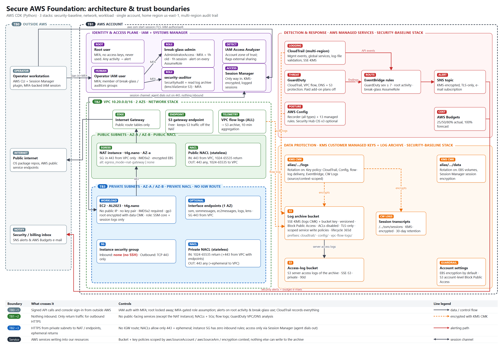

# Secure AWS Foundation (AWS CDK, Python)

A focused, production-minded security baseline for a single AWS account:

| Requirement | Implementation | Stack |
|-------------|----------------|-------|
| Multi-AZ VPC, public/private, controlled egress, least-privilege SGs + NACLs | 2-AZ VPC, NAT instance with 443-only SG/NACLs (or NAT Gateway / no egress), S3 gateway endpoint, flow logs | `network` |
| Multi-region CloudTrail to an encrypted, versioned, private S3 bucket (CMK) | Multi-region trail with log validation, SSE-KMS bucket, versioned, Block Public Access, TLS-only, access-logged | `security-baseline` |
| GuardDuty | Detector with foundational + S3 protection, high-severity findings to email | `security-baseline` |
| Customer-managed KMS keys | `logs` and `data` CMKs with rotation, used by trail, bucket, Config, flow logs, SNS, CloudWatch Logs, EBS, SSM sessions | `security-baseline` |
| Private EC2, no public IP, Session Manager only | AL2023 t4g.nano, no inbound rules, IMDSv2, encrypted EBS, Session Manager preferences with KMS + logging | `workload` |
| Break-glass admin and read-only auditor roles; hardened root | MFA-gated roles + IAM groups, alerts on break-glass use and any root activity, Access Analyzer | `security-baseline` |
| AWS Config or Security Hub | Config recorder + 13 managed rules (Security Hub CIS v3.0.0 behind a flag) | `security-baseline` |



* Architecture diagram and trust boundaries: [docs/ARCHITECTURE.md](docs/ARCHITECTURE.md) (image: [docs/architecture.png](docs/architecture.png))
* Design decisions, cost breakdown and multi-account evolution: [docs/DESIGN.md](docs/DESIGN.md) (image: [docs/design.png](docs/design.png))
* Post-deploy validation checklist and demo script: [docs/VALIDATION.md](docs/VALIDATION.md)
* Regenerate the images after editing the docs: `pip install -r requirements-docs.txt` then `python scripts/render_docs.py` (uses your installed Edge/Chrome)

**Estimated cost with defaults:** about $12–15 a month (about $0.45 a day), us-east-1. See [DESIGN.md §4](docs/DESIGN.md#4-cost-summary-us-east-1-default-flags-approximate).

---

## 1. Manual steps before deploying (one time)

These either cannot be done with IaC or must happen before IaC can run.

### 1.1 Account hardening (as root, then never use root again)
1. Sign in as root and **enable MFA on the root user**: IAM → Security credentials → Assign MFA. Use a hardware key or passkey if possible.
2. Confirm **root has no access keys** (same page). Delete any that exist.
3. Account → **Alternate contacts**: set Security and Billing contacts.
4. Account → **IAM user and role access to Billing information**: *Activate*. Without this, your admin user cannot see Budgets or Cost Explorer.
5. Billing → **Billing preferences**: enable *Free Tier usage alerts* and *PDF invoices by email*.
6. *(Recommended)* Billing → **Budgets**: create a zero-spend or $10 budget now. This catches cost before and during the first deploy. The stack also creates its own budget.

### 1.2 A deployer identity (not root)
Create an **IAM user** (for example `admin-<you>`) with console access, **MFA**, and the `AdministratorAccess` policy, preferably through a group. For CLI credentials, choose one:
* **Preferred:** AWS CLI v2.32+ `aws login`, which uses your console sign-in and issues short-lived credentials (no access keys).
* Or create an access key for the user, use it only for this exercise, and delete it at teardown.
* Or enable IAM Identity Center (requires AWS Organizations) and use `aws configure sso`.

Then sign out of root.

### 1.3 Workstation tooling (Windows)
```powershell
winget install -e --id Python.Python.3.12
winget install -e --id OpenJS.NodeJS.LTS
winget install -e --id Amazon.AWSCLI
winget install -e --id Amazon.SessionManagerPlugin
winget install -e --id Git.Git
# new terminal so PATH refreshes, then:
npm install -g aws-cdk
```
*Node note:* the CDK's jsii runtime officially supports Node 22 and 24. Node 26 works (validated) but prints an "untested node version" banner. Silence it with `$env:JSII_SILENCE_WARNING_UNTESTED_NODE_VERSION=1`, or install `OpenJS.NodeJS.24` instead.

The **Session Manager plugin** is required for `aws ssm start-session` from your laptop. The console's *Connect → Session Manager* works without it.

### 1.4 Pre-flight checks in the target region
The stack creates account/region singletons. If you clicked *Get started* in any of these consoles, a resource may already exist and the deploy will fail.
```powershell
$env:AWS_REGION = "us-east-1"   # recommended region (see note below)
aws sts get-caller-identity
aws guardduty list-detectors                          # expect: []
aws configservice describe-configuration-recorders    # expect: []
aws ssm describe-document --name SSM-SessionManagerRunShell   # expect: InvalidDocument error
aws securityhub describe-hub                          # expect: error (only matters with enable_security_hub)
aws ec2 describe-instance-types --instance-types t4g.nano --query "InstanceTypes[0].InstanceType"
```
If something already exists, either delete it or turn off the matching feature (for example `-c enable_session_manager_prefs=false`).

> **Why us-east-1:** root console sign-ins and calls to the global STS endpoint generate their events in us-east-1, so the root-activity and break-glass alerts are most complete there.

---

## 2. Deploy

```powershell
cd aws-secure-foundation
python -m venv .venv
.\.venv\Scripts\Activate.ps1        # if blocked: Set-ExecutionPolicy -Scope CurrentUser RemoteSigned
pip install -r requirements.txt -r requirements-dev.txt

pytest                                # synth-time security assertions, no AWS calls
cdk synth -c alert_email=you@example.com
cdk synth -c alert_email=you@example.com -c nag=true   # cdk-nag AwsSolutions review: 0 unsuppressed findings

cdk bootstrap                         # once per account/region (creates the CDKToolkit stack)
cdk deploy --all -c alert_email=you@example.com
```
A deploy takes about 10 minutes. Set values permanently in `cdk.json` → `context` instead of passing `-c` each time.

### Configuration flags
| Context key | Default | Effect |
|-------------|---------|--------|
| `alert_email` | `""` | Security alerts and budget email. Without it, no subscription and no budget are created. |
| `monthly_budget_usd` | `25` | Budget alerts at 25/50/80% actual and 100% forecast |
| `egress_mode` | `nat-instance` | `nat-instance` (~$7/mo), `nat-gateway` (~$33/mo + data), `none` (isolated, auto-enables endpoints) |
| `enable_interface_endpoints` | `false` | SSM/SSMMessages/EC2Messages/Logs/KMS endpoints in 1 AZ (~$36/mo) |
| `enable_security_hub` | `false` | Security Hub with the CIS v3.0.0 standard |
| `enable_session_manager_prefs` | `true` | Manage the account's Session Manager preferences document |
| `instance_type` | `t4g.nano` | ARM/x86 AMI chosen automatically |
| `trusted_admin_principal_arns` | `[]` (account) | Restrict who may assume the two roles, for example `-c trusted_admin_principal_arns=arn:aws:iam::123456789012:user/admin-me` |
| `retain_data` | `false` | `true` keeps buckets, keys and log groups on destroy (production behaviour) |
| `nag` | `false` | Run cdk-nag AwsSolutions checks during synth |

### 2.1 Manual steps after deploying
1. **Confirm the SNS subscription** from the "AWS Notification – Subscription Confirmation" email.
2. **Add your IAM user to the groups** `secure-foundation-breakglass` and/or `secure-foundation-securityauditors`. Sign out and back in with MFA, then use the `*SwitchRoleUrl` stack outputs.
   *Note:* an admin user already has `sts:AssumeRole`. The groups are for non-admin humans.

---

## 3. Verify (walkthrough script)

The quick checks are below. **[docs/VALIDATION.md](docs/VALIDATION.md)** has the full checklist, covering every requirement with expected results.

```powershell
# Session Manager: no SSH, no public IP
aws ssm describe-instance-information --query "InstanceInformationList[].{id:InstanceId,ping:PingStatus}"
aws ssm start-session --target <InstanceId output>       # then: curl -sI https://aws.amazon.com | head -1
# Confirm there is no inbound path
aws ec2 describe-instances --instance-ids <id> --query "Reservations[].Instances[].{pub:PublicIpAddress,sg:SecurityGroups}"

# CloudTrail
aws cloudtrail get-trail-status --name secure-foundation-trail
aws cloudtrail describe-trails --query "trailList[].{multi:IsMultiRegionTrail,kms:KmsKeyId,validation:LogFileValidationEnabled}"

# GuardDuty end-to-end: generates sample findings, and the high-severity ones email you
aws guardduty create-sample-findings --detector-id $(aws guardduty list-detectors --query "DetectorIds[0]" --output text) --finding-types "Backdoor:EC2/C&CActivity.B!DNS"

# Config compliance (allow ~15 min after deploy for first evaluations)
aws configservice describe-compliance-by-config-rule --query "ComplianceByConfigRules[].{rule:ConfigRuleName,c:Compliance.ComplianceType}" --output table

# Break-glass alert: assume the role with MFA and an email arrives within a few minutes
```
Expected non-compliance: `EC2_INSTANCE_NO_PUBLIC_IP` and `EC2_INSTANCE_MANAGED_BY_SSM` flag the **NAT instance** (documented exceptions). `ROOT_ACCOUNT_MFA_ENABLED` stays non-compliant until step 1.1 is done.

---

## 4. Teardown

```powershell
cdk destroy --all -c alert_email=you@example.com      # use the same context values as the deploy
python scripts/cleanup_leftovers.py --region us-east-1             # dry run: shows leftovers
python scripts/cleanup_leftovers.py --region us-east-1 --apply     # empties/deletes them
```
* With `retain_data=false` (default), buckets are emptied automatically and removed, log groups are deleted, and both KMS keys are **scheduled for deletion (7-day minimum window, AWS-enforced)**.
* If `cdk destroy` fails with `BucketNotEmpty`, S3 delivered late access logs. Run the cleanup script with `--apply`, then run `cdk destroy --all` again.
* The cleanup script also deletes CloudWatch log groups that CDK custom-resource Lambdas created at runtime.
* **Remove the CDK bootstrap** when finished: `python scripts/cleanup_leftovers.py --region us-east-1 --apply --include-bootstrap`. It deletes the `CDKToolkit` stack, its retained staging bucket and its ECR repository.

**Intentionally retained, documented state** (free, secure; left on as good hygiene before account closure):
* S3 account-level Block Public Access: on
* EBS encryption by default: on
* KMS keys in *PendingDeletion* until the 7-day window passes

Finally, delete the deployer access key if you created one, check Billing → Bills for $0 run-rate, and **close the account** (Account → Close account).

---

## Repository layout
```
app.py                              # wires the three stacks
cdk.json                            # context/config + feature flags
foundation/config.py                # typed, validated config from context
foundation/nag.py                   # cdk-nag suppressions, each with a written justification
foundation/stacks/security_baseline_stack.py
foundation/stacks/network_stack.py
foundation/stacks/workload_stack.py
tests/test_stacks.py                # synth-time security assertions
scripts/cleanup_leftovers.py        # post-destroy cleanup (dry run by default)
scripts/render_docs.py              # renders docs/*.png from the HTML/Markdown sources
docs/ARCHITECTURE.md                # diagram + trust boundaries
docs/DESIGN.md                      # decisions, costs, multi-account evolution
docs/VALIDATION.md                  # post-deploy validation checklist / demo script
docs/architecture.png, design.png   # image versions of the two docs
docs/src/architecture.html          # source of the architecture diagram
```
