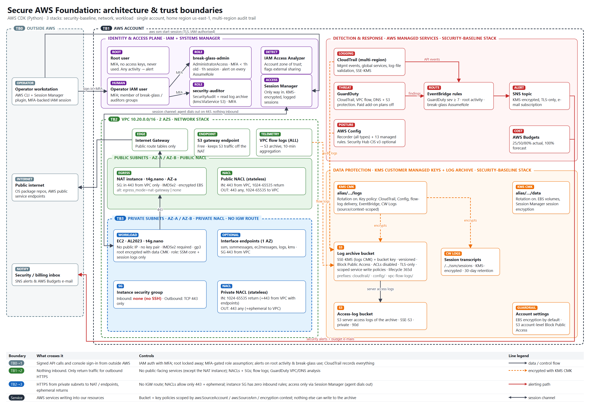
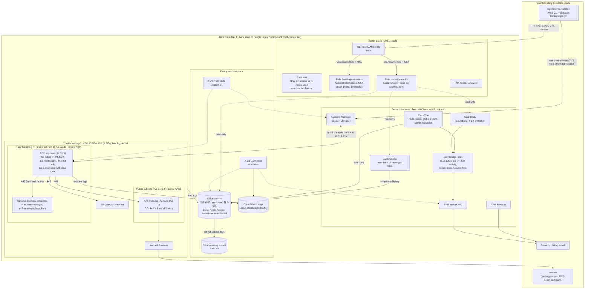

# Architecture and trust boundaries

The PNG above is the primary diagram, generated from [src/architecture.html](src/architecture.html) by `python scripts/render_docs.py`. The Mermaid version below renders natively on GitHub.

Dashed boxes are trust boundaries. Arrows show data and control flow. Everything inside the account boundary is defined in this repo except the root user and the operator's own IAM identity.

## Trust boundaries explained

| # | Boundary | What crosses it | Controls |
|---|----------|-----------------|----------|
| 0 to 1 | Internet / operator to AWS account | Signed API calls, console sign-in | IAM authentication with MFA, root locked away, MFA-gated role assumption, every root action and break-glass use alerts |
| 1 to 2 | AWS control plane to VPC | Nothing inbound. The only ingress path is return traffic | No public-facing resources apart from the NAT instance, NACLs, SGs, flow logs, GuardDuty VPC/DNS analysis |
| 2 to 3 | Public subnets to private subnets | HTTPS from private to NAT, ephemeral return traffic | Private subnets have no IGW route. NACLs allow only 443 plus ephemeral ports. The instance SG has zero inbound rules |
| Service principals | AWS services writing into our resources | CloudTrail, Config, flow log delivery, EventBridge to SNS, CloudWatch Logs | KMS key policy and bucket policy statements scoped by `aws:SourceAccount` / `aws:SourceArn` / encryption context |
